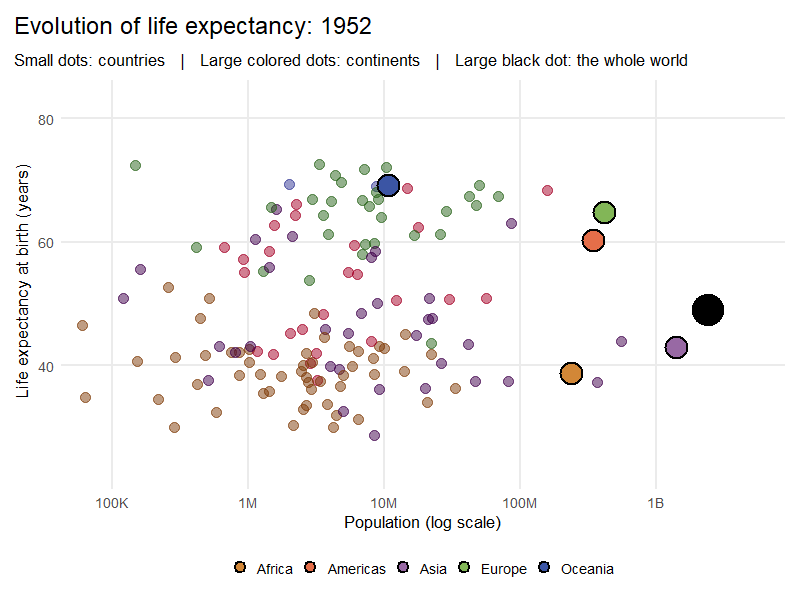

<!-- Header -->

[Assignment](<https://users.dimi.uniud.it/~massimo.franceschet/ns/plugandplay/challenges/gapminder_continent/gapminder_continent.html>)


[Markdown](<https://github.com/xomarpvt/data-challenge/blob/main/07-lifeexp/main.Rmd>)


```{r setup, include=FALSE}
knitr::opts_chunk$set(
    echo = TRUE,
    error = FALSE,
    warning = FALSE
)

library(readr)
library(tidyr)
library(dplyr)
library(gapminder)
library(ggplot2)
library(gganimate)

source("plot.R")
source("anim.R")
```

## Introduction

The [`gapminder` package](https://www.rdocumentation.org/packages/gapminder/versions/1.0.1) contains a dataframe of the same name, which collects demographic and economic information about the countries of the world. Let us start by inspecting its content:

```{r}
glimpse(gapminder::gapminder)
```

The dataframe has six variables:

- `country`: the country of the world; there are 142 in total.
- `continent`: the continent of the country, one of Africa, Americas, Asia, Europe and Oceania.
- `year`: the year the data refer to, from 1952 to 2007 at five-year intervals.
- `lifeExp`: life expectancy (mean length of life) at birth for the people of the country.
- `pop`: total population of the country.
- `gdpPercap`: per-capita GDP (Gross Domestic Product), in international dollars.

```{r echo=FALSE, include=FALSE}
gapminder <- gapminder::gapminder
```

## Data Challenge

Using this dataset, and in particular the variables related to life expectancy and population, we want to study how life expectancy has changed over time for each continent and for the whole planet.

### Population-Weighted Life Expectancy

The data already tell us how life expectancy evolves over time for a single country. To go beyond that, we first need a formula that, given a year and a group of countries, returns the life expectancy of the group as a whole. Once defined, the formula can be applied to any group of countries, such as Western Europe or Latin America, but also to continents and to the entire planet, which is exactly what this data challenge asks for.

Formally, fix a year and consider a set of $n$ countries

$$
C = \{c_1, \dots, c_n\}
$$

where for each country $c_i$ we know its population ${pop}_i$ and its life expectancy ${le}_i$. We define the overall life expectancy ${le}_C$ of the group as:

$$
{le}_C = \frac{\sum_{i = 1}^{n} {le}_{i} \cdot {pop}_{i}}{\sum_{i = 1}^{n} {pop}_{i}}
$$

This is a population-weighted mean. Since the life expectancy of a country is the mean length of life among its people, each country must contribute in proportion to its population: otherwise a small island would count as much as a country of a billion inhabitants. The formula translates directly into an R function (assuming, as above, that the year has already been fixed):

```{r}
life_expectancy <- function(le, pop) {
    sum(le * pop) / sum(pop)
}
```


### Three Levels of Grouping

Now that we have the formula, we apply it to successive levels of grouping, starting from the base dataset. Note that we convert `pop` to a double, since the total population of a continent exceeds the maximum value of an R integer.

- Dataframe for countries:
    ```{r}
    gapminder_countries <- gapminder |>
        mutate(pop = as.numeric(pop)) |>
        select(country, continent, year, lifeExp, pop)
    ```
    ```{r echo=FALSE}
    gapminder_countries
    ```
- Dataframe for continents: we group the countries by year and continent, and apply the formula to the countries of each group.
    ```{r}
    gapminder_continents <- gapminder_countries |>
        group_by(year, continent) |>
        summarise(
            lifeExp = life_expectancy(lifeExp, pop),
            pop = sum(pop),
            .groups = "drop"
        ) |>
        select(continent, year, lifeExp, pop)
    ```
    ```{r echo=FALSE}
    gapminder_continents
    ```
- Dataframe for the entire planet: we group the continents by year and apply the formula once more. This gives the same result as applying it directly to all countries, since the weighted mean of weighted means, with total populations as weights, is the overall weighted mean.
    ```{r}
    gapminder_world <- gapminder_continents |>
        group_by(year) |>
        summarise(
            lifeExp = life_expectancy(lifeExp, pop),
            pop = sum(pop),
            .groups = "drop"
        ) |>
        select(year, lifeExp, pop)
    ```
    ```{r echo=FALSE}
    gapminder_world
    ```

### Visualization

We now write a single parametric function to visualize the evolution of life expectancy over time at the three levels considered.

The function takes a dataframe as input, together with the level of representation and the plot titles. It first draws the lines of life expectancy over the years and then, depending on the level, adds specific elements: legend, points, colors (based on `gapminder::country_colors`) and text labels. Finally, it sets the axis limits, labels and theme.

```{r, echo=FALSE, results='asis'}
code <- paste(readLines("plot.R"), collapse = "\n")

cat(
'<details class="r-code-card">
    <summary>
        <span class="card-info">
            <span class="card-title">Life Expectancy Plot Code</span>
            <span class="card-subtitle">R source code - plot.R</span>
        </span>
        <span class="card-action">
            Click to inspect
            <span class="card-chevron"></span>
        </span>
    </summary>
  <div class="card-body">
````r\n', code, '\n````
</details>\n',
  sep = ""
)
```

Here are the three resulting plots, in sequence:

```{r, dev='svglite', fig.ext='svg', out.width="100%"}
life_exp_plot(
    gapminder_countries,
    title = "Life expectancy by country",
    subtitle = "One line per country   |   Colored by continent"
    )
```

```{r, dev='svglite', fig.ext='svg', out.width="100%"}
life_exp_plot(
    gapminder_continents,
    title = "Life expectancy by continent",
    subtitle = "Population-weighted mean of countries   |   Dot size = total population",
    level = "continent"
    )
```

```{r, dev='svglite', fig.ext='svg', out.width="100%"}
life_exp_plot(
    gapminder_world,
    title = "Life expectancy in the world",
    subtitle = "Population-weighted mean of all countries   |   Dot size = world population",
    level = "world"
    )
```

### What the Plots Show

Starting from the plot by country, the general picture is clear: in almost every country, life expectancy increases over the years. There are, however, some outliers with sharp and sudden drops, probably linked to geopolitical events, internal conflicts, epidemics, or other country-specific causes. Such explanations would be plausible in light of the historical context, but they are not proven by this dataset. Each country would therefore require its own analysis and a case-by-case interpretation.

Aggregating countries by continent smooths out most of this noise and makes the main trends easier to compare. Europe, the Americas, and Oceania follow very similar paths, with high values and a steady but increasingly gradual rise. Africa starts from the lowest values and appears to level off in the 1990s. Asia, by contrast, shows the only decline in the entire plot, around 1960, and the observation is so distant from the overall trend that it appears not to belong to the curve. Confirming its cause would require a country-level breakdown and, ideally, input from a domain expert.

The same outlier is even more evident in the world plot, which consists of a single curve shown on a narrower scale and therefore clearly reflects the Asian decline. Apart from this outlier, the growth in global life expectancy resembles the first part of a logistic curve: annual gains are smaller than they were fifty years ago, but there is no clear plateau yet, and the increase has been almost linear in recent decades. Since the data end in 2007, we cannot determine whether the curve will eventually level off.

### Everything in One Plot

To conclude, we can bring all the data together in a single animated plot. It shows the evolution of life expectancy over the years (the progression of time), with the logarithm of the population on the x axis. Countries are drawn as small dots, while continents and the world are drawn as larger ones, to emphasize that each of them summarizes the countries it contains.

```{r eval=FALSE}
life_exp_anim(
    gapminder_countries,
    gapminder_continents,
    gapminder_world,
    nframes=600, fps=60, end_pause=150,
    file = "anim.gif"
    )
```
```{r, echo=FALSE, results='asis'}
code <- paste(readLines("anim.R"), collapse = "\n")

cat(
'<details class="r-code-card">
    <summary>
        <span class="card-info">
            <span class="card-title">Life Expectancy Animation Code</span>
            <span class="card-subtitle">R source code - anim</span>
        </span>
        <span class="card-action">
            Click to inspect
            <span class="card-chevron"></span>
        </span>
    </summary>
  <div class="card-body">
````r\n', code, '\n````
</details>\n',
  sep = ""
)
```


```{r anim-gif, echo=FALSE, out.width="100%"}

```

The animation lets us follow the whole story at once. African countries start from the lowest values and gain the most in the first decades, but by 2007 they still have to catch up with the rest of the world. Europe, the Americas and Oceania, on the other hand, approach 80-85 years and seem to be nearing a ceiling, as the gains become smaller and smaller. Finally, it is interesting to see that Asia and the world follow a very similar path and end up close to each other, both in life expectancy and in population. This is expected, since Asia holds most of the world population and therefore dominates the weighted mean.

### Final Thoughts

Overall, the population-weighted mean gave us a single measure that works at every level, from countries to the whole planet. Through it we saw that life expectancy increased almost everywhere and that the gap between continents has narrowed without closing. The main exceptions are tied to specific historical events, which the aggregated plots can only hint at. Two limitations are worth keeping in mind: the data stop in 2007, with observations every five years, and using grouping mean hides large differences between countries of the same continent.

<!-- Footer -->
<hr/>
<p style="text-align: center;">Created by <a href="https://github.com/xomarpvt/">Omar Paviotti</a></p>
<p style="text-align: center;"><span style="color: #808080;"><em>omar.paviotti@spes.uniud.it</em></span></p>